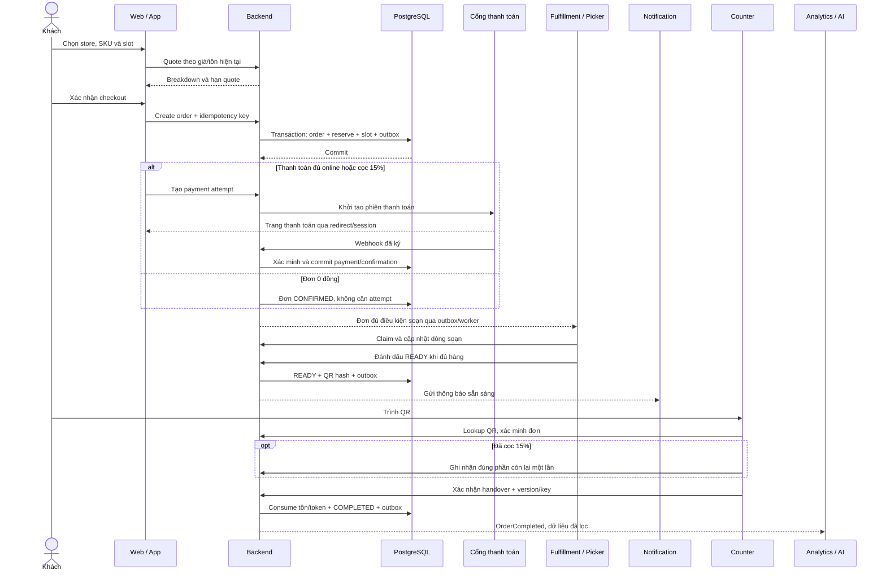

# Click & Collect đầu cuối

## Mục đích và thứ tự giao dịch

Luồng này cụ thể hóa bảy bước nghiệp vụ: chọn hàng → chọn slot/trả tiền → xác nhận giữ hàng → phân công → soạn → nhận → học từ dữ liệu. Về kỹ thuật, **phải tạo đơn chờ và giữ tồn/slot trước khi yêu cầu cổng thu tiền**. Màn hình khách có thể gộp thao tác “chọn thanh toán”, nhưng không được thu thành công trước rồi mới thử giữ hàng mà không có quy trình hoàn.

Luồng online và trả tại quầy dùng cùng quy tắc tồn/QR, khác điều kiện xác nhận tiền. Sơ đồ thể hiện MVP local transaction; khi tách microservices chuyển sang saga theo [thiết kế sự kiện](microservices-va-su-kien.md).

## Bước 1 — chọn cửa hàng và thêm hàng

Tồn hiển thị là available tại thời điểm đọc. Thêm giỏ không reserve để tránh khóa hàng do giỏ bỏ quên. Đổi store phải xem lại chênh giá và SKU không bán; tắt định vị vẫn chọn địa chỉ thủ công. Search/cache có thể trễ nên checkout luôn kiểm tra lại nguồn chuẩn.

## Bước 2–3 — slot, đơn và thanh toán

Quote tính giá, voucher, phí, slot và hai phương án tiền do server quyết định nhưng không giữ chỗ. Checkout reserve tồn/slot/quota nguyên tử với order snapshot. `ONLINE` snapshot `FULL_ONLINE`; `PAY_AT_PICKUP` snapshot `DEPOSIT_15`, làm tròn lên đến đồng. Với tổng lớn hơn 0, cả hai vào PENDING_PAYMENT và chỉ CONFIRMED sau khi khoản `amountDueNow` được xác minh; browser redirect không đủ.

Hết hạn, hủy hoặc lỗi tài nguyên phải trả giữ chỗ một lần. Thanh toán đến sau deadline tạo nghĩa vụ hoàn/đối soát và không khôi phục đơn. Tạo payment attempt lỗi không xóa đơn còn hạn; retry không tạo đơn mới.

## Bước 4 — phân công picker và lộ trình

MVP dùng picker claim hoặc manager phân công với version/kiểm tra vai trò. Fulfillment Agent giai đoạn sau gợi ý người theo store, ca làm, backlog và deadline; backend xác minh điều kiện, quyền và xung đột trước chấp nhận. Ban đầu manager duyệt gợi ý; tự động phân công chỉ bật với policy rõ và kill switch sau đánh giá.

Lộ trình cần SKU có khu/kệ và sơ đồ store có version. Nếu chưa có dữ liệu hoặc AI lỗi, dùng thứ tự khu/kệ cấu hình hoặc soạn thủ công. Không trì hoãn đơn đã xác nhận chỉ vì agent không phản hồi.

## Bước 5 — soạn và báo sẵn sàng

Picker quét đối chiếu SKU/số lượng; hàng thiếu/hỏng tạo issue cho manager, không tự thay. READY chỉ khi đủ dòng và đã kiểm tra đóng gói. Backend tạo QR và outbox gửi thông báo. Gửi push/SMS/email/Zalo lỗi không làm mất READY; khách vẫn xem trạng thái trên trang đơn. Mỗi kênh chỉ bật khi có tích hợp, template/consent và cấu hình thực tế.

## Bước 6 — khách nhận hàng

Counter lookup rồi xác nhận riêng; đúng store, token còn hạn/chưa dùng, đơn READY, tiền đủ và version hiện hành. Với đơn cọc, counter chỉ được ghi đúng số dư còn lại sau khi cọc đã trả và chỉ một lần. Một transaction bàn giao ghi COMPLETED, consume token/reservation, trừ tồn và outbox. Retry không thu/trừ tồn/bàn giao lần hai.

MVP nhận tại quầy có nhân viên. Tủ tự động/điểm nhận tự phục vụ là mở rộng: cần danh tính thiết bị, cấp ô, giao thức mở khóa, cảm biến/bằng chứng nhận, lệnh có nonce/idempotency và xử lý cửa mở nhưng callback mất. Không dùng việc quét QR đơn thuần làm bằng chứng hàng đã rời tủ.

## Bước 7 — dữ liệu và vòng cải tiến

Outbox phát OrderCompleted và các mốc soạn/bàn giao. Pipeline dedup eventId, kiểm tra schema, giữ event-time, đưa lỗi vào vùng cách ly; sau đó tạo fact đơn/dòng hàng đã lọc PII cho dashboard và feature AI. Payment/refund events cập nhật fact tiền riêng, không suy ra doanh thu chỉ từ lượt thanh toán.

Theo dõi search → add cart → order → completed, thời gian queue/soạn/chờ nhận, stockout, hủy/no-show và hoàn. Không đưa QR, OTP, raw chat hay địa chỉ vào warehouse mặc định. Dataset huấn luyện phải có cutoff thời gian, version và quyền sử dụng; retrain/eval/duyệt trước phát hành, không tự học online từ mọi sự kiện chưa kiểm tra.

## Điểm kiểm soát

| Tình huống | Hành vi bắt buộc | Kiểm thử liên quan |
| --- | --- | --- |
| Tồn/slot cuối, retry checkout | Một kết quả hợp lệ, không giữ chỗ mồ côi | TC-06..09, TC-23 |
| Callback trùng/trễ | Dedup, xác minh tiền, không sống lại đơn hết hạn | TC-10..12, TC-22 |
| Picker/AI không khả dụng | Claim/phân công thủ công, không đổi quy tắc quyền | TC-13, TC-29 |
| Thiếu SKU, chưa đủ dòng | Không READY; manager xử lý | TC-14, TC-24 |
| QR trùng, sai store, chưa thu | Chặn bàn giao; kiểm tra collection trước retry | TC-15..17 |
| Worker/pipeline lỗi | Outbox giữ sự kiện; replay không lặp tác dụng | TC-20, TC-31 và kiểm thử mở rộng event pipeline |

Các trạng thái chính thức, thời điểm trừ tồn và hủy/no-show theo [luồng nghiệp vụ](luong-nghiep-vu.md).
