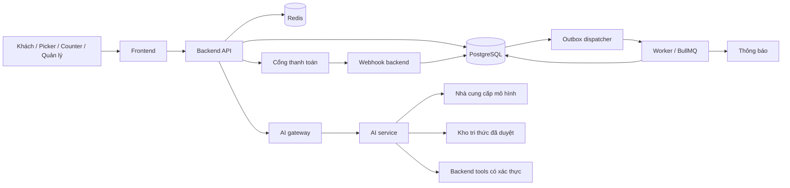

# Kiến trúc hệ thống

## Phương án đề xuất

Kiến trúc đích của ShopGo là **microservices + event-driven trên cloud**. MVP bắt đầu bằng modular monolith có ranh giới module rõ, sau đó tách dần theo tải, nhu cầu triển khai và năng lực vận hành. Sơ đồ dưới đây mô tả giai đoạn MVP; [kiến trúc đích và hợp đồng sự kiện](microservices-va-su-kien.md) mô tả giai đoạn phân tán, còn [ma trận công nghệ](cong-nghe-de-xuat.md) phân biệt lựa chọn nền tảng với phương án cần thử nghiệm.

Frontend Next.js + TypeScript + Tailwind; backend NestJS dạng modular monolith; AI service Python + FastAPI. PostgreSQL là nguồn dữ liệu giao dịch chính. Redis phục vụ cache và hàng đợi BullMQ. Đây là lựa chọn thiết kế, chưa hàm ý đã cài thư viện hay có dịch vụ hoạt động.

## Trách nhiệm theo thư mục

| Thành phần | Trách nhiệm | Biên giới dữ liệu |
| --- | --- | --- |
| frontend/src/app | Route groups storefront, picker, counter, admin | Không tự quyết định quyền hay tính tiền |
| frontend/src/features | Cart, checkout, orders, inventory, assistant | Gọi API; quản lý trạng thái tải/lỗi và đồng bộ |
| backend/src/modules | Auth, users, stores, catalog, inventory, cart, orders, payments, fulfillment, delivery, promotions, notifications, reports, ai-gateway | Chủ sở hữu các thao tác nghiệp vụ |
| backend/src/common, config | Guard, lỗi, logging, DTO, cấu hình | Chuẩn dùng chung, tránh dồn nghiệp vụ vào common |
| backend/src/database | Schema ứng dụng, migration, seed | Migration thực thi duy nhất ở đây theo ADR-001 |
| backend/src/jobs | Outbox, hết hạn reservation, gửi thông báo, đối soát | Xử lý ít nhất một lần, handler phải idempotent |
| ai-service/app | API, agents, tools, RAG, ML, prompts, guardrails, core | Không ghi trực tiếp bảng đơn/tồn/tiền |
| packages/shared-types, api-contracts | DTO công khai, enum, schema API | Không xuất entity nội bộ hay secret |
| database | ERD, tài nguyên SQL dùng chung có tài liệu | Không duy trì bản migration ứng dụng thứ hai |
| infra | Docker, proxy, cấu hình giám sát; k8s tùy giai đoạn | Không đưa Kubernetes vào điều kiện MVP |

## Giao tiếp và xác thực

Ở MVP, reverse proxy và backend đảm nhiệm chức năng gateway cần thiết. Khi có nhiều dịch vụ, API Gateway là điểm vào chung cho Web, Mobile, Store App và Shipper App: định tuyến, xác minh danh tính, rate limit và truyền trace context. OAuth2 dùng cho cấp quyền tích hợp khi cần; đăng nhập liên kết dùng OIDC theo nhà cung cấp. JWT là một định dạng token có thể dùng cho access token, không thay thế kiểm tra quyền tài nguyên ở dịch vụ sở hữu dữ liệu.

Frontend gọi backend qua HTTPS. Browser không giữ secret dịch vụ. Access/refresh session, cookie và CSRF phải được chọn và kiểm chứng như một bộ nhất quán; đề xuất cookie HttpOnly và bảo vệ CSRF cho thao tác ghi, không lưu refresh token trong localStorage.

Backend gọi AI bằng danh tính dịch vụ. Mỗi yêu cầu AI có user/store scope, deadline và trace ID. Khi AI gọi tool, backend kiểm tra lại danh tính khách và quyền thao tác; không tin userId/storeId do mô hình tự sinh.

Kênh realtime gửi thông báo thay đổi kèm entityId/version; frontend tải lại trạng thái từ API. Mất WebSocket dùng polling có backoff. Sự kiện realtime không phải nguồn dữ liệu quyết định bàn giao hoặc thu tiền.

## Tính tin cậy

- Giao dịch checkout ghi order, lines, reservation, slot booking và outbox cùng transaction. Lời gọi cổng thanh toán thực hiện sau commit để không giữ khóa DB khi chờ mạng.
- Khóa/cập nhật có điều kiện các bản ghi tồn và slot theo thứ tự ổn định; retry deadlock hữu hạn.
- Redis không giữ bản duy nhất của đơn hoặc reservation. Worker quét DB để khôi phục công việc hết hạn bị bỏ lỡ.
- Outbox và queue có retry, backoff, dead-letter. Consumer lưu eventId đã xử lý hoặc dùng trạng thái có điều kiện để tránh tác dụng lặp.
- Thanh toán là hệ thống bên ngoài: dùng attempt, webhook inbox và tác vụ đối soát; không cố dùng một transaction DB bao trùm cổng thanh toán.
- Backend vẫn đặt/soạn/bàn giao được khi AI lỗi. Trang sản phẩm có fallback khi cache lỗi; tải giảm bằng giới hạn kết nối và cache có TTL.

## Hướng mở rộng

Tách dịch vụ khi có dữ liệu về tải hoặc nhu cầu triển khai độc lập, không tách ngay từng module. Đọc báo cáo nặng có thể chuyển sang read model; delivery và AI có thể mở rộng worker riêng. Quyết định ORM, nhà cung cấp cloud, OTP, thanh toán và mô hình AI còn mở ở sổ quyết định.

Đích triển khai gồm User/Auth, Catalog, Inventory, Order, Payment, Fulfillment, Delivery, Promotion/Loyalty, Notification và AI Gateway. Analytics nhận sự kiện qua pipeline, không đọc trực tiếp bảng giao dịch để phục vụ mọi truy vấn phân tích. Kafka hoặc RabbitMQ là phương án broker cho giai đoạn phân tán; BullMQ hiện mô tả hàng đợi tác vụ MVP, không mặc định tương đương broker liên dịch vụ.

Khi tách dịch vụ, mỗi dịch vụ sở hữu dữ liệu và migration của mình; không tiếp tục giả định transaction checkout bao trùm nhiều DB. Phải chuyển sang saga với reservation/compensation và kiểm thử recovery trước cutover. Chi tiết ở [ADR-003](../adr/0003-tach-dich-vu-va-hop-dong-su-kien.md).
