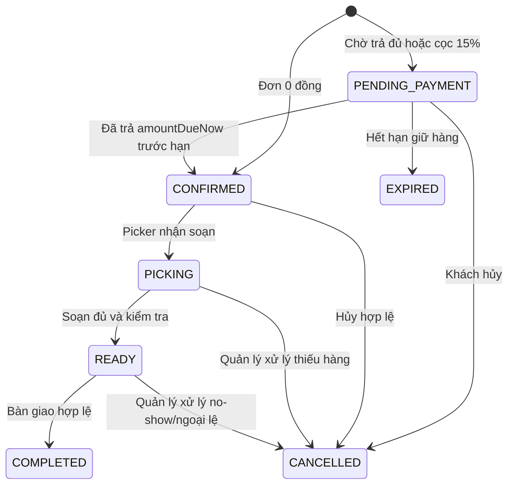

# Luồng nghiệp vụ và trạng thái

Luồng bảy bước có sơ đồ tương tác giữa khách, cổng tiền, picker, counter và analytics ở [Click & Collect đầu cuối](click-and-collect.md). Các transaction trong tài liệu này áp dụng MVP modular monolith; kiến trúc tách DB dùng [saga](microservices-va-su-kien.md).

## 1. Quote và checkout

1. Khách chọn store, SKU, số lượng, slot và voucher. Giỏ không giữ tồn.
2. Backend tạo quote có version giỏ, giá, chiết khấu, phí, tổng tiền và expiresAt. Quote không bảo đảm còn hàng hay suất.
3. Checkout kèm quoteId và Idempotency-Key; backend xác minh quote chưa hết hạn, dữ liệu không đổi, cửa hàng nhận đơn.
4. Trong một transaction: kiểm tra tồn khả dụng, giữ từng SKU, chiếm suất slot, ghi đơn/dòng snapshot và outbox. Mọi bước lỗi đều rollback.
5. Khách chọn trả đủ online hoặc đặt cọc 15% online và trả phần còn lại tại quầy. Với tổng lớn hơn 0, cả hai phương án đều tạo order PENDING_PAYMENT và reservation ACTIVE có hạn; tỷ lệ/số tiền được backend tính và snapshot trên đơn.
6. Tạo payment attempt sau commit với đúng `amountDueNow`. Khi đủ khoản ban đầu trước hạn, đơn chuyển CONFIRMED và reservation COMMITTED. Nếu cổng lỗi, khách thử lại trên cùng đơn còn hạn; không tạo đơn mới chỉ vì trình duyệt tải lại.

## 2. Trạng thái đơn Click & Collect

COMPLETED, CANCELLED và EXPIRED là trạng thái cuối. Hoàn tiền/đổi trả sau COMPLETED được quản lý bằng hồ sơ riêng, không đổi ngược trạng thái đơn. Mọi transition kiểm tra version và ghi lịch sử. Không cung cấp API sửa tùy ý trường status.

## 3. Giữ tồn và trừ tồn

- available = on_hand − reserved; luôn có on_hand ≥ reserved ≥ 0.
- ACTIVE: reserved tăng, on_hand chưa đổi. Khi thanh toán đủ online hoặc khoản cọc 15% thành công, reservation chuyển COMMITTED. COMMITTED vẫn chiếm reserved và không bị job hết hạn thanh toán thu hồi.
- Bắt đầu soạn không trừ on_hand. Hàng đã lấy trên kệ vẫn thuộc tồn vật lý và được giữ cho đơn.
- Khi bàn giao: COMMITTED → CONSUMED; cùng transaction giảm on_hand và reserved theo số lượng, tạo stock ledger, hoàn tất đơn.
- Khi hủy/hết hạn: ACTIVE hoặc COMMITTED → RELEASED; reserved giảm một lần. Hàng đã soạn phải được xác nhận trả về khu vực bán hoặc chuyển xử lý hư hỏng trước khi mở bán lại.
- Nếu hàng hỏng/thiếu khiến on_hand thực tế thấp hơn reserved, mở sự cố; không ép số tồn âm hay bỏ qua các đơn đang giữ. Quản lý hủy/xử lý các đơn bị ảnh hưởng rồi ghi điều chỉnh có audit.

## 4. Thanh toán và hết hạn chạy đồng thời

Webhook phải xác minh theo hợp đồng cổng đã chọn: chữ ký, merchant, reference, amount, currency và trạng thái, rồi lưu event duy nhất. Webhook và job expiry cùng khóa đơn/reservation để quyết định một kết quả.

Nếu đơn còn PENDING_PAYMENT và thời gian DB chưa quá expiresAt, chuyển PAID + CONFIRMED + COMMITTED cùng transaction. Nếu quá hạn, kể cả job chưa chạy, kết thúc EXPIRED và trả reservation/slot; tiền đã thu chuyển REFUND_PENDING. Không tự khôi phục đơn đã hủy/hết hạn. Payment attempt bị thu trùng cần hoàn phần thu dư và tạo sự cố đối soát.

## 5. Soạn và bàn giao

Picker nhận đơn có điều kiện version để tránh hai người cùng nhận. Danh sách soạn hiển thị vị trí kệ nếu đã có dữ liệu; tối ưu lộ trình là mở rộng. SKU thiếu phải báo quản lý; MVP không tự thay hoặc sửa tiền đơn đã thanh toán.

READY phát sinh token QR ngẫu nhiên, lưu hash, có expiresAt. QR không chứa SĐT, địa chỉ hay quyền thanh toán. Counter xem trước đơn qua token; xác nhận bàn giao là request riêng có quyền, version và idempotency key. Trả tại quầy ghi nhận collection với người thu trước khi chuyển COMPLETED; thanh toán online yêu cầu PAID. Token được tiêu thụ trong cùng giao dịch bàn giao. Token hết hạn có thể cấp lại sau kiểm tra khách và đơn; token cũ bị thu hồi.

## 6. Hủy, no-show, hoàn tiền và slot

Khách tự hủy trước PICKING theo policy cấu hình; sau đó cần quản lý xử lý. Chính sách MVP hiện tạo refund request cho toàn bộ tiền online đã thu, kể cả khoản cọc; chưa tự động tịch thu cọc do no-show. Không đánh dấu REFUNDED chỉ vì đã gửi lệnh; worker/callback/đối soát cập nhật kết quả thực tế.

Slot booking ACTIVE chiếm sức chứa; RELEASED trả suất nếu hủy/hết hạn. Bàn giao chuyển FULFILLED và vẫn tính vào tổng lượng đã phục vụ của slot; không mở lại sức chứa để nhận thêm đơn quá năng lực ban đầu. Job no-show chỉ cảnh báo; quản lý quyết định gia hạn/hủy, kiểm tra hàng lạnh và hoàn tiền theo policy cần chốt.

## 7. Giao tận nơi — thiết kế giai đoạn sau

Đơn có fulfillmentMethod DELIVERY, địa chỉ snapshot và delivery job riêng: UNASSIGNED → ASSIGNED → ACCEPTED → PICKED_UP → DELIVERED, kèm nhánh REJECTED/FAILED/RETURNING/RETURNED. Chỉ hoàn tất đơn khi DELIVERED và thỏa điều kiện thu tiền. Điểm trừ tồn dự kiến khi bàn giao hàng cho shipper, cần ADR riêng để phân biệt tồn cửa hàng, hàng đang giao và hàng hoàn; không dùng nguyên luồng CONSUMED tại quầy cho delivery.
