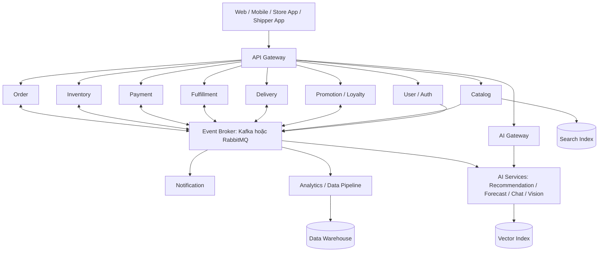

# Kiến trúc microservices và event-driven

## Mô hình đích và giai đoạn áp dụng

Mô hình đích triển khai trên cloud, phục vụ Web, Mobile App, Store App và Shipper App qua API Gateway. MVP vẫn dùng modular monolith để giữ các transaction tồn/slot/đơn đơn giản; sơ đồ này thể hiện ranh giới trách nhiệm sau khi tách dịch vụ, không phải topology đã triển khai.



Sơ đồ lược bỏ DB và cache của từng dịch vụ để dễ đọc. PostgreSQL giữ giao dịch, Redis giữ cache/trạng thái ngắn hạn phù hợp; Elasticsearch/OpenSearch, vector index và warehouse là bản chiếu chuyên dụng, không được dùng làm nguồn quyết định còn hàng hoặc đã thu tiền.

## Trách nhiệm và quyền sở hữu

| Service | Dữ liệu sở hữu | API/command chính | Sự kiện tiêu biểu |
| --- | --- | --- | --- |
| User/Auth | User, identity, session, membership/role | Login, khóa tài khoản, cấp quyền | UserCreated, MembershipChanged, UserLocked |
| Catalog | Product, SKU, category, giá bán cơ sở theo store | Tra cứu/cập nhật catalog và giá | ProductUpdated, StorePriceChanged |
| Inventory | Balance, reservation, stock ledger | Reserve, commit, release, consume | InventoryReserved, InventoryReservationRejected, InventoryReleased, InventoryConsumed |
| Order | Order, dòng snapshot, quote, timeline, checkout saga | Create, confirm, cancel, đọc trạng thái | OrderCreated, OrderConfirmed, OrderCancelled, OrderExpired, OrderCompleted |
| Payment | Attempts, webhook inbox, collections, refunds | Khởi tạo trả tiền, ghi thu, yêu cầu hoàn | PaymentSucceeded, PaymentFailed, RefundSucceeded, RefundFailed |
| Fulfillment | Slot/capacity, booking, assignment, tiến độ soạn, QR | Book/release slot, claim, ready, handover | SlotBooked, SlotBookingRejected, OrderPickingStarted, OrderReady, HandoverAccepted |
| Delivery | Delivery job, shipper assignment, proof, COD settlement | Gán/nhận job, nhận hàng, giao, đối soát | DeliveryAssigned, DeliveryCompleted, DeliveryFailed |
| Promotion/Loyalty | Voucher policy/redemption, điểm và ledger điểm | Validate/reserve/release voucher, cộng/trừ điểm | VoucherReserved, VoucherReservationRejected, LoyaltyPointsGranted |
| Notification | Template, kênh, consent, delivery attempts | Gửi thông báo theo sự kiện | NotificationDelivered, NotificationFailed |
| AI Gateway / AI Services | Routing, proposal, run trace, phiên bản model/index | Chat, recommend, forecast, tool mediation | AIProposalCreated, ForecastPublished |
| Analytics | Event ingestion, fact/dimension, aggregate | Báo cáo phân tích và dữ liệu huấn luyện đã duyệt | AnalyticsBatchProcessed |

Fulfillment sở hữu slot trong kiến trúc đích; Order chỉ giữ slotId và snapshot. Catalog sở hữu giá bán cấu hình, Promotion sở hữu quy tắc giảm giá, Order sở hữu giá đã chốt trên đơn. Quyền điều chỉnh giá và phê duyệt vẫn ở backend quản trị, không ở model AI.

## Đồng bộ và bất đồng bộ

Gọi đồng bộ cho tương tác cần phản hồi tức thì như catalog, quote, tra đơn và kiểm tra quyền. Đặt timeout, giới hạn retry và truyền requestId. Sự kiện dùng cho thông báo, read model, analytics và phối hợp quy trình dài. Không để browser chờ một chuỗi vô hạn các lời gọi giữa dịch vụ.

Gateway không chứa logic tính giá, giữ tồn hoặc trạng thái đơn. Nó xác minh token theo issuer/audience/thời hạn và chuyển danh tính đã kiểm chứng; từng service tiếp tục kiểm tra hành động, store scope và ownership. Service-to-service dùng danh tính riêng, không tin header userId do client cung cấp.

## Hợp đồng sự kiện

```json
{
  "eventId": "d0819a59-c958-4ed2-909c-12edc42a4e99",
  "eventType": "order.confirmed",
  "schemaVersion": 1,
  "producer": "order-service",
  "aggregateType": "order",
  "aggregateId": "8d16ca94-607d-4f13-916e-cc665d85bb64",
  "aggregateVersion": 2,
  "occurredAt": "2026-11-12T03:00:00Z",
  "correlationId": "checkout-example-001",
  "causationId": "7b112894-42b8-405d-82d0-e4dd71f4716a",
  "storeId": "4910464b-b301-4115-9a08-2d3b1cff1490",
  "payload": {
    "orderId": "8d16ca94-607d-4f13-916e-cc665d85bb64",
    "fulfillmentMethod": "PICKUP",
    "paymentSummary": "PAID"
  }
}
```

- Phân biệt command (yêu cầu làm, có thể bị từ chối) và event (sự thật đã commit). Agent không tự phát PaymentSucceeded/OrderCompleted.
- Delivery ít nhất một lần: producer ghi outbox cùng transaction; consumer ghi inbox/receipt cùng tác dụng local. Không hứa exactly-once xuyên broker, DB và cổng tiền.
- Dùng aggregateId làm khóa phân vùng/định tuyến khi cần thứ tự theo thực thể; aggregateVersion giúp phát hiện trùng, cũ hoặc thiếu. Không giả định có thứ tự toàn cục giữa mọi service.
- Sự kiện version bị thiếu cần retry/read model rebuild theo hợp đồng; không áp bừa sự kiện tương lai lên trạng thái cũ. Schema thay đổi phá tương thích cần version mới và thời gian chuyển đổi.
- Retry có backoff/jitter, giới hạn số lần và dead-letter. Replay phải giữ eventId, có audit và không tự gửi lại SMS/thu/hoàn tiền.
- Payload chứa ID và dữ liệu tối thiểu; không phát raw QR, OTP, access token, địa chỉ hay nội dung chat lên bus dùng chung.

## Checkout saga sau khi tách DB

Không dùng một transaction PostgreSQL để bao trùm Order, Inventory, Fulfillment và Promotion đã độc lập. Order điều phối checkout saga có sagaId, trạng thái bền vững và deadline:

1. Tạo checkout operation nội bộ, chưa công bố đơn đã xác nhận; reserve tồn, slot và quota voucher bằng command idempotent.
2. Mỗi service tự commit reservation local rồi trả kết quả/sự kiện. Các giữ chỗ có deadline và có thể gia hạn theo policy.
3. Nếu bất kỳ bước nào thất bại, phát release cho các bước đã thành công; retry bù trừ đến trạng thái kết thúc. Đọc trạng thái saga cho phép khôi phục sau crash.
4. Chỉ chuyển đơn PENDING_PAYMENT hoặc CONFIRMED sau khi mọi giữ chỗ cần thiết đã được xác minh. Thiết kế API tương lai có thể trả 202 + operationId khi saga chưa hoàn tất; phải version hóa/điều chỉnh hợp đồng trước tách.
5. Online: tạo payment session sau khi giữ chỗ đủ. Callback thành công kích hoạt commit reservations; nếu giữ chỗ hết hạn/bị mất, chuyển xử lý hoàn tiền, không tự xác nhận lại tồn không còn.
6. PAY_AT_PICKUP: commit giữ chỗ trước cho vào hàng đợi soạn. Handover cũng là workflow idempotent có các bước kiểm tra token, thu tiền, consume tồn và hoàn tất; phải thiết kế recovery riêng trước tách Fulfillment/Inventory.

State nội bộ của saga tách khỏi enum OrderStatus công khai của MVP. Quyền sở hữu từng bước, trường hợp timeout/compensation và tiêu chí hoàn tất handover phải được đặc tả bổ sung trước khi chuyển dịch vụ giao dịch sang DB riêng.

## Lộ trình tách

1. MVP: module interfaces, local transaction và outbox; worker tác vụ BullMQ; bổ sung event envelope từ sớm.
2. Tách consumer ít phụ thuộc: Notification, analytics pipeline, AI jobs; triển khai broker khi cần fan-out/durable integration.
3. Tách read-heavy Catalog/Search nếu có lợi ích đo được; index có đường rebuild, không ảnh hưởng nguồn chuẩn.
4. Delivery có thể tách khi phát triển giai đoạn giao hàng; không yêu cầu tách checkout ngay.
5. Order/Inventory/Payment/Fulfillment/Promotion chỉ tách sau khi saga, reconciliation, tracing và lỗi mạng đã được kiểm thử.

Mỗi lần tách cần hợp đồng, chủ sở hữu DB/migration, SLO, tải baseline, kế hoạch backfill/cutover, rollback và diễn tập replay. Không dual-write hai DB mà không có cơ chế đồng bộ/đối soát được kiểm chứng. Xem [ADR-003](../adr/0003-tach-dich-vu-va-hop-dong-su-kien.md).
