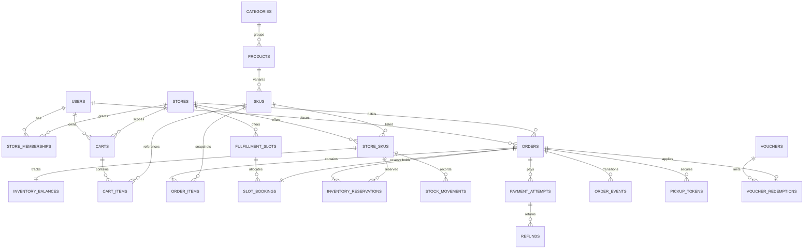

# Mô hình dữ liệu và ERD

## Quy ước

PostgreSQL giữ dữ liệu giao dịch. Khóa chính đề xuất UUID, thời gian dùng timestamptz, tiền dùng bigint VND, số lượng nguyên dương cho MVP. Các bảng có created_at, updated_at; tài nguyên có cập nhật đồng thời dùng version. Tên vật lý snake_case, JSON API camelCase. ERD dưới đây mô tả quan hệ chính; bảng vận hành và mở rộng liệt kê riêng.

## Các nhóm bảng

| Nhóm | Bảng | Vai trò |
| --- | --- | --- |
| Danh tính | users, auth_sessions, otp_challenges, store_memberships | Tài khoản, phiên, OTP băm/hạn dùng, vai trò theo store |
| Hàng hóa | categories, products, skus, store_skus | Mô tả chung, biến thể, barcode, giá, trạng thái bán và hạn gần nhất của tồn hiện tại theo store |
| Tồn kho | inventory_balances, inventory_reservations, stock_movements | Số dư, giữ tồn, ledger bất biến |
| Giỏ/quote | carts, cart_items, checkout_quotes | Giỏ theo store, dòng hàng, snapshot tính giá có hạn |
| Đơn | orders, order_items, order_events, picking_assignments | Snapshot đơn, dòng hàng, lịch sử và người soạn |
| Nhận hàng | fulfillment_slots, slot_bookings, pickup_tokens | Sức chứa và QR một lần |
| Tiền | payment_attempts, payment_webhook_inbox, counter_collections, refunds | Lần thử trả tiền, sự kiện cổng, thu tại quầy, hoàn |
| Khuyến mãi | vouchers, voucher_redemptions | Điều kiện và sử dụng voucher có quota |
| Vận hành | outbox_events, consumer_receipts, idempotency_records, audit_logs, support_cases | Đồng bộ tin cậy, chống lặp và hỗ trợ |
| AI | conversations, messages, ai_tool_runs, knowledge_documents, knowledge_chunks, recommendation_events | Phiên chat, provenance, phiên bản tri thức và đo chất lượng |

## Ràng buộc nhất quán

1. Cặp (store_id, sku_id) duy nhất trong store_skus/inventory_balances. Đường giữ tồn phải xác minh SKU thuộc đúng store của đơn.
2. Snapshot order_items lưu sku_code, name, unit_price, quantity, discount, line_total. Thay danh mục sau đó không đổi đơn cũ.
3. order total = subtotal − discount + fee. Chiết khấu không vượt giá trị được áp; tổng không âm. Giá và voucher do server tính.
4. Bảng quote lưu cart_version, pricing_version, slot_id, expires_at; quote được dùng tối đa một lần tạo đơn thành công.
5. Thanh toán thành công không được suy ra từ trạng thái đơn; refund và collection là các dòng tiền độc lập có liên kết.
6. Không cascade delete lịch sử đơn/tiền/tồn khi xóa tài khoản hoặc SKU. Dùng vô hiệu hóa và quy trình ẩn danh dữ liệu phù hợp.
7. Các bản ghi reserve và slot được ghi trong transaction checkout; outbox trong transaction thay đổi nghiệp vụ; ngoại lệ được bù trừ qua sự kiện.

## Index và tăng trưởng

Đề xuất index orders(store_id, status, created_at), orders(user_id, created_at), reservation(status, expires_at), slots(store_id, starts_at), outbox(status, available_at), payment(provider, provider_reference), audit(entity_type, entity_id, created_at). Barcode có unique theo chính sách SKU toàn hệ thống cần chốt. Index tìm kiếm tiếng Việt được chọn sau thử nghiệm corpus; không coi tìm kiếm ngữ nghĩa là điều kiện cho giao dịch cơ bản.

Hội thoại, log và sự kiện tăng nhanh cần retention/archival. Chỉ bổ sung partition hoặc kho phân tích sau khi đo khối lượng thực tế. Không đưa dữ liệu khách thật vào seed, notebook hoặc snapshot test.

## Mở rộng có chủ đích

delivery_jobs, delivery_events, delivery_proofs, cod_settlements cho giao hàng; loyalty_accounts/transactions cho điểm; reviews cho đánh giá; return_requests/return_items cho đổi trả từng phần; inventory_lots để quản lý nhiều lô và nhiều hạn cho cùng SKU. MVP hiện lưu `store_skus.expires_on` như hạn gần nhất của tồn hiện tại; định giá cận date theo từng lô vẫn cần `inventory_lots` ở giai đoạn sau.
