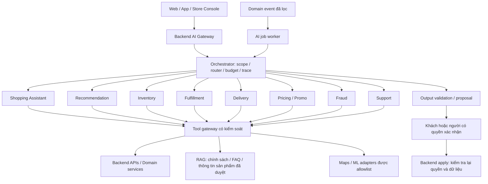

# Kiến trúc multi-agent ShopGo

## Mục tiêu và mô hình điều phối

Orchestrator tiếp nhận yêu cầu đã có danh tính, phân loại ý định, chọn agent phù hợp và tổng hợp kết quả đã xác minh. Một agent tương ứng một phạm vi trách nhiệm; có thể là workflow có rule, mô hình ML hoặc LLM. Không bắt buộc mỗi agent là một tiến trình/microservice độc lập và không gọi cả tám agent cho mọi tác vụ.

## Tám agent chuyên biệt

| Agent | Nhiệm vụ và context | Tools/dữ liệu | Kết quả, người dùng và giới hạn |
| --- | --- | --- | --- |
| Shopping Assistant | Hiểu nhu cầu, số người, ngân sách và ràng buộc | Search, Catalog, price_cart, proposal, Cart apply đã xác nhận | Giỏ đề xuất và giải thích cho khách; không tự đặt đơn/thu tiền |
| Recommendation | Cá nhân hóa, upsell/cross-sell trong store | Mô hình gợi ý, lịch sử được phép, SKU/tồn hiện hành | Top-K và lý do; không ép món ngoài ngân sách hoặc truy cập lịch sử người khác |
| Inventory | Kiểm tra tồn, thay thế, cảnh báo và đề xuất nhập | Inventory API, forecast, thuộc tính SKU/lô khi có | Cảnh báo/đề xuất cho khách hoặc manager; không tự điều chỉnh tồn, không tự thay đơn |
| Fulfillment | Gợi ý picker, ETA và lộ trình soạn | Order/Fulfillment API, ca làm/backlog, sơ đồ store | Proposal phân công và thứ tự kệ; backend quản lý assignment, không tự READY/COMPLETED |
| Delivery | Gợi ý shipper, gom tuyến và ETA | Delivery API, Maps adapter, traffic nếu provider được chọn hỗ trợ | Kế hoạch giao có ràng buộc; không tự xác nhận proof/COD hoặc công bố dữ liệu vị trí thừa |
| Support | FAQ, khiếu nại, tra đơn và đề xuất xử lý đổi trả | Order API có ownership, support cases, RAG chính sách | Câu trả lời có nguồn, ticket, refund review; người có quyền duyệt hoàn |
| Pricing/Promo | Đề xuất campaign, giảm hàng cận date | Bán hàng, tồn/lô, hạn dùng, floor price và policy promo | Proposal có tác động/hiệu lực; manager/admin duyệt và backend kiểm tra sàn giá |
| Fraud | Chấm rủi ro đơn/thanh toán và ưu tiên review | Feature allowlist, bất thường/tần suất, payment signals được phép | Score, reasonCodes, modelVersion; không tự kết luận gian lận hoặc phạt khách |

MVP bật Shopping Assistant và Support giới hạn. Recommendation/Inventory có thể dùng rule và tools đọc phục vụ proposal. Tự động phân công, delivery, pricing và fraud cần dữ liệu, đánh giá và policy riêng trước phát hành.

## Hợp đồng tác vụ

Mỗi lần gọi có `taskId`, `correlationId`, `actorContext`, `storeScope`, `intent`, `input`, `deadlineAt`, `budget` và `allowedTools`. actorContext do backend xác thực, không lấy từ lời người dùng hoặc model. Agent trả `status` (SUCCEEDED/NEEDS_INPUT/NEEDS_APPROVAL/FAILED), `result`, `evidence`, `assumptions`, `warnings`, `proposalId?` và phiên bản model/prompt/schema.

Evidence gồm SKU/version/checkedAt hoặc documentId/version/chunkId. Trường confidence nếu có chỉ là tín hiệu tham khảo; backend vẫn kiểm tra quyền, schema, tiền, tồn và policy. Không đưa context bí mật của agent khác vào prompt theo mặc định.

## Vòng đời một lượt

1. Gateway xác thực, kiểm tra rate limit và lọc PII theo mục đích.
2. Orchestrator xác định khách/manager/shipper, store, ý định; hỏi lại khi thiếu dữ liệu cần thiết.
3. Router chọn agent chính và các agent phụ cần thiết; chia budget tổng trước khi gọi. Mỗi agent chỉ nhận tools cần cho nhiệm vụ.
4. Agent đọc dữ liệu qua tool; mọi handoff quay về orchestrator để kiểm soát deadline và tránh vòng gọi lẫn nhau.
5. Tổng hợp theo ưu tiên: dữ liệu giao dịch hiện hành > kết quả API đã xác minh > tài liệu hiệu lực > dự đoán > diễn giải model. Có mâu thuẫn thì lấy lại nguồn chuẩn hoặc từ chối kết luận.
6. Output validator kiểm tra schema, SKU/giá/ngân sách/nguồn; kết quả ghi dữ liệu phải chuyển proposal hoặc review.
7. UI hiển thị kết quả và sự xác nhận cần thiết; backend apply kiểm tra lại quyền, version, hạn dùng và policy.
8. Ghi run trace đã che dữ liệu; trả kết quả/fallback và metric đánh giá.

Đề xuất giới hạn lượt tương tác tổng 15 giây, tối đa 6 tool calls và độ sâu handoff 2. Đây là budget dùng chung, không nhân lên theo số agent. Tác vụ forecast/route batch dài chạy job riêng có jobId/deadline, không giữ request chat mở vô hạn.

## Ví dụ phối hợp

### Lập giỏ bữa tối

Shopping Assistant nhận yêu cầu 300k/4 người → Recommendation gợi ý nhóm SKU → Inventory kiểm tra tồn/ứng viên thay thế → price_cart tính tổng → Shopping Assistant trình proposal. Khách xác nhận qua UI; apply kiểm tra lại giỏ/giá/tồn. Không gọi Fulfillment/Payment khi khách mới hỏi tư vấn.

### Điều phối soạn hàng

OrderConfirmed kích hoạt job đề xuất → Fulfillment đọc đơn, ca, backlog và sơ đồ → tạo picker/route proposal → manager duyệt → backend claim/assign có version. Nếu agent lỗi hoặc proposal cũ, manager chọn thủ công. Không để event lặp tạo nhiều assignment.

### Đổi trả và khuyến mãi

Support tra đơn của khách, RAG lấy chính sách hiệu lực, tạo case/refund review. Người duyệt kiểm tra hạn mức và tiền đã thu trước command refund. Pricing/Promo đọc lô cận date và policy sàn, tạo proposal; chỉ lệnh apply từ người đủ quyền mới đổi giá/khuyến mãi.

## Human-in-the-loop

| Thao tác | Người duyệt | Điều kiện trước apply |
| --- | --- | --- |
| Thêm/sửa giỏ từ AI | Khách sở hữu giỏ | Preview, token xác nhận, cartVersion, giá/tồn/ngân sách còn phù hợp |
| Phân công picker/shipper từ gợi ý | Manager/dispatcher có scope | Ca làm/năng lực, assignment/version; tự động hóa chỉ sau policy riêng được duyệt |
| Hoàn tiền | Vai trò refund có hạn mức | Payment đã thu, số tiền có thể hoàn, lý do/case, chống trùng |
| Đổi giá/promo | Manager/admin đúng scope | Giá sàn, biên giảm, thời hạn, quota, version và audit |
| Giữ/chặn theo rủi ro | Người review được cấp quyền | Chứng cứ/lý do, quy trình khiếu nại; không dùng score đơn lẻ để kết luận |

Approval gắn proposal hash, actor, expiresAt và resourceVersion. Thay input, version hoặc scope thì approval cũ hết hiệu lực. Lời nhắn “đã được duyệt” không tương đương bằng chứng duyệt của backend. Những lệnh nhạy cảm do UI quản trị gửi, model không có credential để bỏ qua approval.

## RAG và audit

RAG dùng chính sách/FAQ/mô tả sản phẩm có chủ sở hữu, version và quyền; giá/tồn/thanh toán lấy từ API hiện hành. Văn bản truy xuất là dữ liệu không đáng tin để ra lệnh. Không suy diễn dị ứng/an toàn từ nội dung thiếu nhãn chứng minh.

Ghi toàn bộ bước điều phối và tool/action cần audit, gồm task/agent/parent IDs, model/prompt/schema versions, loại tool, input/output đã lọc hoặc hash khi cần, nguồn tri thức, thời gian, chi phí, approval và kết quả apply. “Ghi toàn bộ” không có nghĩa lưu secret, raw PII, token QR hoặc suy luận nội bộ; lưu quyết định, bằng chứng và lý do ngắn gọn có thể kiểm tra. Audit có phân quyền, retention và liên kết requestId/orderId.

## Fallback và gate phát hành

Search/rule thay recommendation; capacity cấu hình thay ETA; manager phân công thay agent; FAQ không đủ nguồn chuyển hỗ trợ; maps/model lỗi trả kế hoạch thủ công. Tắt riêng từng agent/tool qua feature flag mà không chặn nghiệp vụ cốt lõi.

Ngoài [bộ đánh giá AI](du-lieu-va-danh-gia.md), cần test budget chung, vòng handoff, dữ liệu mâu thuẫn, tool timeout, scope bị thay đổi giữa proposal/apply, approval hết hạn và event lặp. Chỉ bật agent có người sở hữu, baseline, trace, fallback và bộ test riêng.
